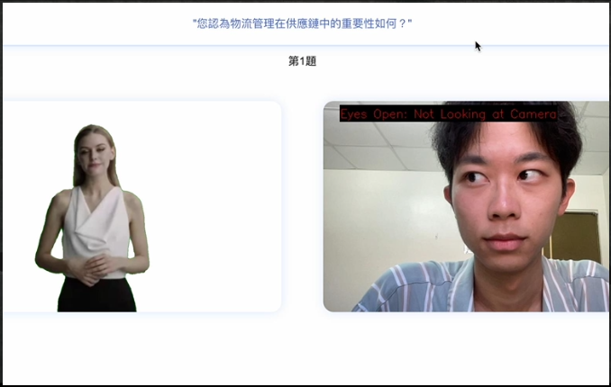
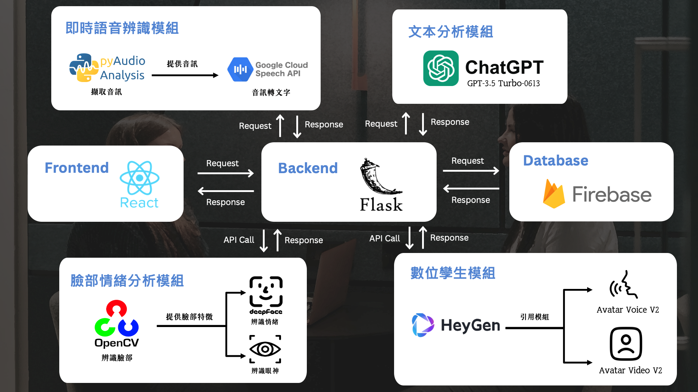

# MetaView - 新一代多模態 AI 模擬面試系統

**MetaView** 是一款結合數位孿生與多模態分析的新一代智慧模擬面試系統，旨在解決傳統線上模擬面試缺乏真實感、回饋不足的痛點。我們透過擬真的數位面試官、個人化的題目以及即時的多面向分析，為使用者提供沈浸式且富有洞見的面試練習體驗。

## 專案目標與痛點

傳統的模擬面試系統往往存在以下問題：
- **缺乏真實感與帶入感：** 面試官多為靜態貼圖或制式化模型，互動體驗差。
- **題目籠統：** 無法針對個人履歷提出客製化問題。
- **分析維度單一：** 僅做簡單的情感分析，缺乏對眼神、語氣等非語言訊息的綜合回饋。
- **互動延遲：** 無法做到即時語音辨識與追問，多為手動文字輸入。

**MetaView** 針對以上痛點，提出整合性的解決方案，旨在提高練習的 **準確度**、**真實度** 與 **回饋深度**。

## 主要功能

- **數位擬真面試官：** 整合 **HeyGen** 數位人技術，打造栩栩如生的面試互動體驗，提升面試的真實感與沉浸感。
- **個人化題目生成：** 能夠分析使用者上傳的履歷（PDF），並由 **ChatGPT** 產生高度相關的個人化面試題目。
- **即時多模態分析：**
    - **情緒分析 & 眼神追蹤：** 透過 **OpenCV** 進行臉部偵測，再利用 **deepFace** 深度學習模型即時分析面部情緒（包含六種核心情緒）與眼神專注度。
    - **即時語音辨識：** 整合 **Google Cloud Speech API**，將使用者的語音回答即時轉換為文字，實現流暢的互動。
- **智慧回覆分析與建議：** 利用 **ChatGPT** 分析使用者的回答內容與結構，提供具體、可執行的改善建議，而不僅僅是簡單的情感判斷。

## 技術架構

- **Frontend:** 使用 **React** 打造互動式使用者介面，包含即時影音串流、面試結果視覺化圖表等。
- **Backend:** 以 **Flask** 框架作為後端核心，負責處理 API 請求、整合各大 AI 模型服務，並進行業務邏輯運算。
- **Database:** 採用 **Firebase** 作為資料庫，儲存使用者資料與面試記錄。
- **AI 模組整合:**
    - **文本分析：** 串接 **OpenAI (ChatGPT)** API 進行提問生成與回答分析。
    - **數位人：** 串接 **HeyGen** API 驅動數位面試官的影像與語音。
    - **語音辨識：** 使用 **PyAudio** 擷取本機音訊，並傳送至 **Google Cloud Speech API** 進行即時語音轉文字。
    - **臉部與情緒分析：** 透過 **OpenCV** 抓取視訊鏡頭畫面，再交由 **deepFace** 函式庫進行臉部特徵提取、情緒辨識與眼神追蹤。